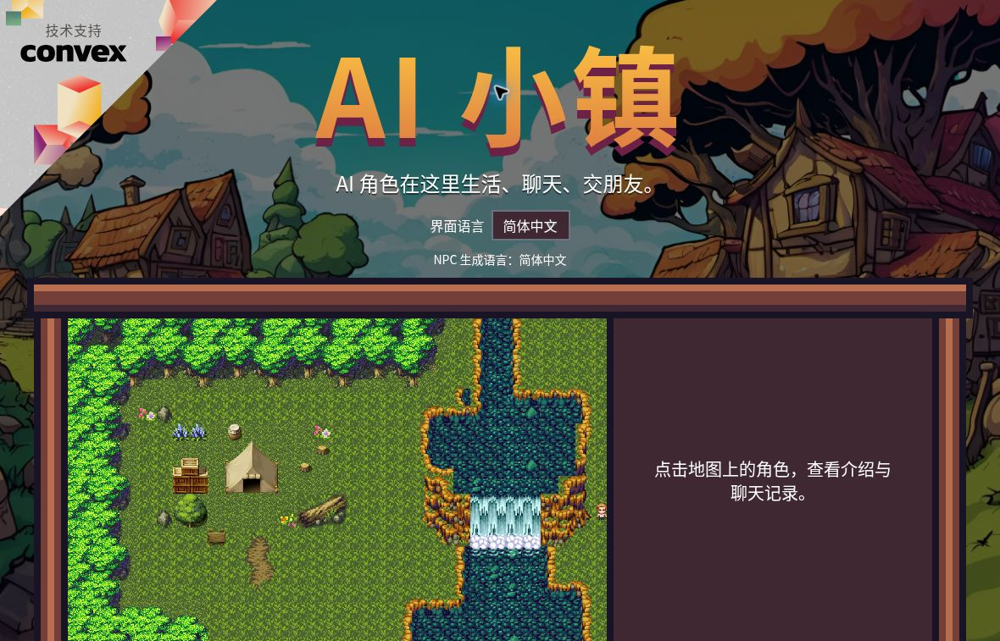

# AI Town Enhanced

[简体中文](README.md) · [Setup guide](docs/GETTING_STARTED.md) · [Documentation](docs/README.md) ·
[Validation and limits](docs/VALIDATION.md)

An unofficial enhancement of [a16z-infra/ai-town](https://github.com/a16z-infra/ai-town), adding
persistent NPC state, hybrid decisions and Chinese/English interfaces to the original pixel world.



This screenshot is from a local Convex-backed game with fixture dialogue. This repository is not an
already-hosted public game service.

## Features

- **12 residents in fresh worlds.** Existing worlds retain their residents, IDs and custom profiles;
  initialization does not automatically add or replace people.
- **Persistent personality and goals.** Energy, stress, goal progress, cooldown and inertia inform
  decisions.
- **Directed social memory.** Trust, familiarity, affinity, conflict and bounded event memories
  evolve from events. A completed conversation records contact, not inferred positive sentiment.
- **Classic, Mock and Hybrid policies.** Hybrid combines legal utility candidates with structured
  Decisions selection. Unavailable or invalid responses fall back safely.
- **NPC inspector.** Inspect state, goals, relationships, decision source, usage and execution
  outcomes. Selection and execution are recorded separately.
- **Chinese and English.** Game and editor interfaces support both languages. The browser's
  interface locale and the shared NPC generation language are separate settings; old history is not
  rewritten.
- **Original engine retained.** Convex simulation, movement, collisions, PixiJS rendering and the
  real LLM/vector-memory path remain, with Canvas fallback when WebGL is unavailable.

## Run locally without a model API key

Use Node.js 20 or 22 and npm. Clone the default `main` branch:

```sh
git clone https://github.com/kiva-9/ai-town.git
cd ai-town
npm ci
```

In terminal 1, start the official account-free local backend and wait for functions to be ready:

```sh
CI=1 CONVEX_AGENT_MODE=anonymous npx convex dev
```

Keep it running. In terminal 2:

```sh
npx convex env set NPC_DECISION_MODE mock
npx convex env set NPC_DIALOGUE_MOCK true
npx convex env set NPC_LANGUAGE en
npx convex env set NPC_ALLOW_MODE_CONTROL true
npx convex run init '{"numAgents":12}'
npm run dev:frontend
```

Open the Vite URL, normally **http://localhost:5173/ai-town/**, and select English in the interface
if desired. Click a resident to expand the NPC inspector.

Mock decisions and Mock dialogue are separate switches. The setup above enables both, avoiding model
API calls. Dialogue is visibly labeled `[Mock dialogue]`; it is a fixture, not model-generated
conversation. Hosting services may still charge if you choose to use them.

`NPC_ALLOW_MODE_CONTROL=true` lets anyone who can access the deployment change its global policy and
NPC language. Use it only on a trusted local backend. Disable it for public hosting unless
owner-only access is implemented. Never expose API keys in `VITE_` variables, commits or
screenshots.

See the [setup guide](docs/GETTING_STARTED.md) for self-hosted alternatives, provider configuration
and preserving existing worlds.

## Validation boundaries

The recorded 2026-11-09 validation passed 173 Jest tests, 3 editor tests and the production build.
Lint reported 0 errors and 251 warnings. Desktop Chromium and a narrow CSS viewport were checked; a
real phone and system IME composition were not fully tested. Check CI for the current commit and
[the full validation report](docs/VALIDATION.md) for evidence.

**No successful live Decisions API call or real Chinese LLM/summary/vector-retrieval quality
evaluation is claimed.** Live calls require your own server-side key, project access and verified
prices. The application's spending reservation is not a provider-enforced billing ceiling.

The [offline evaluation](docs/EVALUATION.md) uses controlled synthetic events. Its Hybrid strategy
is explicitly labeled utility fallback, and it does not establish that NPCs are more natural.

```sh
npm run check
npm run evaluate:npcs -- --seed 42 --steps 120 --out evaluation-output
```

## Documentation and CI

- [Current setup](docs/GETTING_STARTED.md) and [Decisions API contract](docs/DECISIONS_API.md)
- [World engine architecture](ARCHITECTURE.md) and
  [hybrid NPC architecture](docs/HYBRID_ARCHITECTURE.md)
- [Evaluation method](docs/EVALUATION.md) and
  [recorded results](docs/evaluation-results/evaluation.md)
- [Graphical QA](docs/GRAPHICAL_QA.zh-CN.md), [upstream audit](docs/UPSTREAM_AUDIT.md) and
  [historical upstream README](docs/UPSTREAM_README.md)

[Hybrid NPC checks](.github/workflows/hybrid-npc.yml) is the only GitHub workflow. It runs offline
tests, build, lint and evaluation on pushes and pull requests, then uploads evaluation artifacts. It
does not deploy the app or call paid model APIs. Existing Docker Compose, Fly.io and Vercel files
remain optional upstream recipes, not verified production deployment for this fork.

## Attribution and license

Based on **[a16z-infra/ai-town](https://github.com/a16z-infra/ai-town)** under the
[MIT License](LICENSE), with the upstream copyright notice retained. Inspired by
[Generative Agents](https://arxiv.org/abs/2304.03442).

Built on [Convex](https://convex.dev/) and [PixiJS](https://pixijs.com/). Original tiles and art are
credited to [George Bailey](https://opengameart.org/content/16x16-game-assets),
[hilau](https://opengameart.org/content/16x16-rpg-tileset) and
[ansimuz](https://opengameart.org/content/tiny-rpg-forest); original UI assets are from
[Mounir Tohami](https://mounirtohami.itch.io/pixel-art-gui-elements). Full original credits remain
in the [upstream README](docs/UPSTREAM_README.md#stack). Check each art source's license when
reusing its assets.
