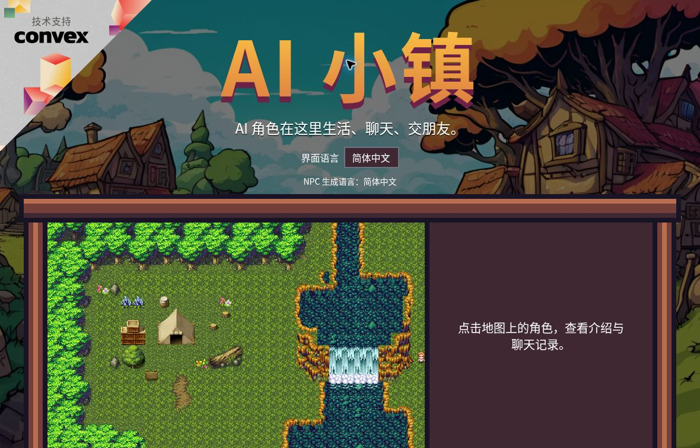

# AI 小镇增强版 · AI Town Enhanced

[English](README.en.md) · [中文运行指南](docs/GETTING_STARTED.zh-CN.md) · [文档索引](docs/README.md)
· [验收与限制](docs/VALIDATION.md)

基于 [a16z-infra/ai-town](https://github.com/a16z-infra/ai-town)
的非官方增强版。在原有像素小镇、移动、碰撞和对话系统上，增加持续的 NPC 状态、混合决策和中英文界面。



截图来自本地 Convex 后端的 Mock 模式实跑，详情见[图形验收](docs/GRAPHICAL_QA.zh-CN.md)。本仓库不是已经上线的公共游戏服务。

## 这个版本有什么

- **12 位居民**：新世界默认创建 12 位 NPC。旧世界保留原有居民和 ID，不自动补人或替换资料。
- **持续人格和目标**：稳定人格、能量/压力状态、目标进度、行为冷却与惯性。
- **有方向的社交记忆**：信任、熟悉度、好感、冲突与有限事件记忆随交互更新。普通结束对话只记录接触，不擅自判定为愉快或关系修复。
- **三种行为策略**：Classic 保留上游策略；Mock 提供可复现的离线决策；Hybrid 将传统效用候选与结构化 Decisions 选择结合，并在不可用时回退。
- **可观察的决策过程**：角色智能面板显示状态、目标、关系、最近决策、来源、用量与执行结果。候选选择和实际执行分别记录。
- **中英文体验**：游戏、角色资料、地图/精灵编辑器可切换语言。界面语言按浏览器保存；NPC 生成语言是独立的共享设置，只影响之后的文本。
- **保留原版基础**：Convex 世界引擎、路径规划、PixiJS 渲染与真实 LLM/向量记忆路径仍在；无 WebGL 时可使用 Canvas 回退。

## 先跑不需要模型 API Key 的版本

需要 **Node.js 20 或 22、npm**，以及允许运行本地 Convex 后端的环境。克隆默认 `main`
分支即可，不需要切换旧功能分支。

```sh
git clone https://github.com/kiva-9/ai-town.git
cd ai-town
npm ci
```

终端 1：启动官方、无需账号的本地开发后端，等待函数就绪，并保持运行。

```sh
CI=1 CONVEX_AGENT_MODE=anonymous npx convex dev
```

终端 2：同时启用 **Mock 决策和 Mock 对话**，再初始化世界并启动前端。

```sh
npx convex env set NPC_DECISION_MODE mock
npx convex env set NPC_DIALOGUE_MOCK true
npx convex env set NPC_LANGUAGE zh-CN
npx convex env set NPC_ALLOW_MODE_CONTROL true
npx convex run init '{"numAgents":12}'
npm run dev:frontend
```

打开 Vite 输出的地址，通常是 **http://localhost:5173/ai-town/**。点击居民可展开“角色智能”。

- Mock 对话显示“【模拟对话】”，是固定话术，不是真实模型生成；仅把决策设为 Mock 并不会关闭真实对话调用。
- `NPC_ALLOW_MODE_CONTROL=true`
  允许访问该后端的人修改全局模式和 NPC 语言，只用于可信本地环境。公开部署前应关闭它或实现仅所有者可用的权限控制。
- Convex 通常会在本地生成 `VITE_CONVEX_URL`。不要把 API Key 放进任何 `VITE_` 变量，也不要提交
  `.env.local` 或本地数据库。
- 本地后端受限时，见[运行指南](docs/GETTING_STARTED.zh-CN.md)中的自托管说明。运行 Mock 不需要模型 API 费用；自行使用云托管等服务仍可能计费。

## 接入真实模型前

Decisions 负责结构化行为选择，原版 LLM/embedding 负责自然语言与向量记忆，两者单独配置、单独计费。

1. 阅读[中英文运行指南](docs/README.md#运行与配置)和 [Decisions 接口说明](docs/DECISIONS_API.md)。
2. 在服务器配置自己的 Key，确认项目接口权限，并核实当前模型价格。四项 Token 单价缺失或无效时，客户端不会发送真实请求。
3. 先保留 Mock 对话，只验证 Decisions；随后再单独配置对话与 embedding 服务。
4. 设置请求频率、并发和预算，并在供应商侧设置适用的费用控制。仓库内预算是保守准入估算，不是供应商保证的硬性账单上限。

**目前没有真实 Decisions API 成功记录，也没有真实中文 LLM 对话、摘要或向量检索质量评测。**
离线测试与 Mock 演示不能代替这些验证。完整范围见 [VALIDATION.md](docs/VALIDATION.md)。

## 测试与复现

```sh
# Jest、编辑器语言测试、TypeScript/Vite 构建、ESLint
npm run check

# 固定初始状态与事件的离线策略对照
npm run evaluate:npcs -- --seed 42 --steps 120 --out evaluation-output
```

[已记录验收](docs/VALIDATION.md)：173 项 Jest 测试、3 项编辑器测试和生产构建通过；lint 为 0
errors、251 warnings。该记录对应 2026-11-09 的功能验收，最新结果以当前提交的 CI 为准。

实验使用受控合成事件；没有真实 API 时，Hybrid 结果明确标为 utility
fallback。不能据行动次数、关系指标或 Mock 话术声称 NPC 已经“更自然”。见[实验方法](docs/EVALUATION.md)和[样例结果](docs/evaluation-results/evaluation.md)。

## 文档与目录

- [中文运行指南](docs/GETTING_STARTED.zh-CN.md) / [English setup](docs/GETTING_STARTED.md)
- [原有世界引擎架构](ARCHITECTURE.md) / [混合 NPC 架构与安全边界](docs/HYBRID_ARCHITECTURE.md)
- [中文本地化审计](docs/LOCALIZATION_AUDIT.zh-CN.md) / [图形验收与截图](docs/GRAPHICAL_QA.zh-CN.md)
- [上游代码审计](docs/UPSTREAM_AUDIT.md) / [上游历史 README](docs/UPSTREAM_README.md)
- `convex/npc/`：状态、策略、Decisions 客户端、队列和测试。
- `convex/aiTown/`、`convex/engine/`：世界逻辑与有序模拟引擎。
- `src/`、`src/editor/`、`data/`：游戏界面、编辑器、地图与居民资料。

## CI 与部署范围

仓库当前只保留
[Hybrid NPC checks](.github/workflows/hybrid-npc.yml)：在 push/PR 时运行离线测试、构建、lint 和实验，并上传实验产物。CI 不部署应用、不需要模型密钥，也不运行付费 API 冒烟测试。

Docker
Compose、Fly.io 和 Vercel 文件是保留的上游可选配置，不是已启用的 GitHub 部署流程。本次整理没有创建或启用自动部署；相关历史操作放在[上游参考](docs/UPSTREAM_README.md)，不作为增强版的生产验收承诺。

## 来源与许可证

本项目基于 **[a16z-infra/ai-town](https://github.com/a16z-infra/ai-town)**，遵循
[MIT License](LICENSE)，保留原作者版权声明。研究灵感来自
[Generative Agents](https://arxiv.org/abs/2304.03442)。

- 后端与数据： [Convex](https://convex.dev/)；游戏渲染： [PixiJS](https://pixijs.com/)。
- 图块资源：
  [George Bailey](https://opengameart.org/content/16x16-game-assets)、[hilau](https://opengameart.org/content/16x16-rpg-tileset)、[ansimuz](https://opengameart.org/content/tiny-rpg-forest)。
- 原版 UI 资源： [Mounir Tohami](https://mounirtohami.itch.io/pixel-art-gui-elements)。
- 原型参考与其他工具署名完整保留在[上游 README](docs/UPSTREAM_README.md#stack)。美术资源仍需遵循各来源的许可要求。
